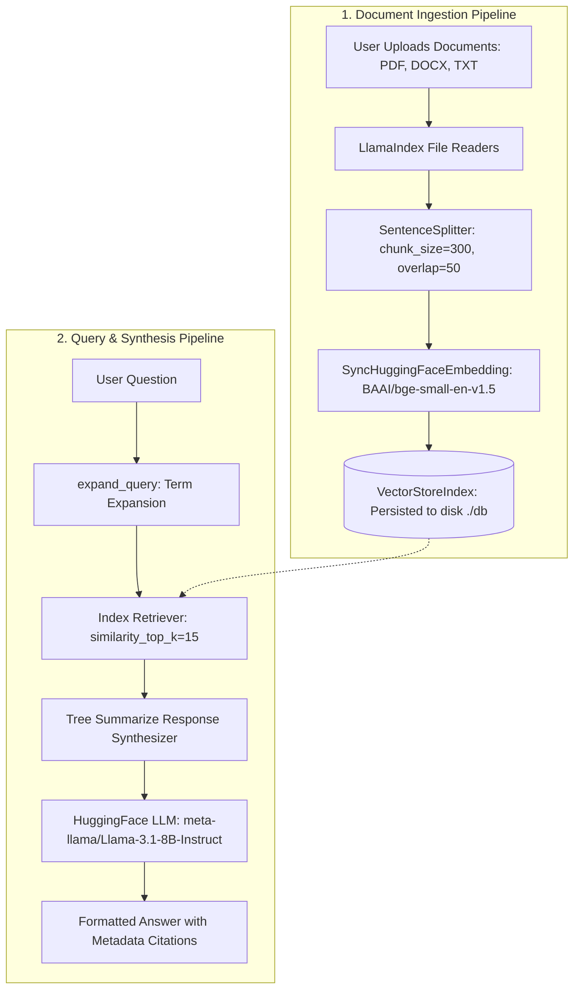

# 🤖 Multi-Document AI RAG Assistant

[](https://www.python.org/downloads/)
[](https://fastapi.tiangolo.com)
[](https://www.llamaindex.ai/)
[](https://huggingface.co/)
[](https://opensource.org/licenses/MIT)

An intelligent, full-stack **Retrieval-Augmented Generation (RAG)** assistant designed to ingest, process, and query multi-format enterprise documents (`.pdf`, `.docx`, `.txt`). 

Powered by **LlamaIndex** orchestration, **Hugging Face Serverless Inference API** (`Llama-3.1-8B-Instruct` & `bge-small-en-v1.5`), and a high-performance **FastAPI** backend with an integrated responsive web UI featuring light and dark modes.

---

## 📑 Table of Contents

- [Overview](#-overview)
- [Key Features](#-key-features)
- [Architecture & Workflow](#-architecture--workflow)
- [Tech Stack](#-tech-stack)
- [Project Structure](#-project-structure)
- [Local Setup Guide](#-local-setup-guide)
- [Configuration](#-configuration)
- [Running the Application](#-running-the-application)
- [API Reference](#-api-reference)
- [Roadmap & Improvements](#-roadmap--improvements)
- [License](#-license)

---

## 🌟 Overview

Standard large language models often struggle with document-specific knowledge and risk hallucinations when asked about private files. This project implements a production-grade RAG pipeline that:

1. Ingests user-uploaded documents without saving proprietary files to cloud databases.
2. Embeds text into dense semantic vectors using `BAAI/bge-small-en-v1.5`.
3. Stores vector indices locally for lightning-fast retrieval.
4. Synthesizes strictly context-grounded responses using `meta-llama/Llama-3.1-8B-Instruct` via serverless inference, eliminating heavy local GPU requirements.

---

## ✨ Key Features

- **Multi-Format File Support**: Upload and process `.pdf` (via `PDFReader`), `.docx` (via `DocxReader`), and `.txt` (via `FlatReader`) documents simultaneously.
- **Serverless AI Inference**: No expensive GPU setup required—leverages Hugging Face's hosted inference client for both embedding extraction and LLM text generation.
- **Strict Hallucination Prevention**: Prompt engineering ensures the model answers exclusively based on retrieved context, gracefully stating when information is missing.
- **Rule-Based Query Expansion**: Enriches procedural and calculative queries (e.g., questions with *"how"*, *"calculate"*, *"interest"*) with analytical synonyms for higher recall.
- **Modern Embedded UI**:
  - Built directly into the FastAPI server (zero Node.js/npm dependencies).
  - Modern typography, document upload status, responsive layout, and real-time message stream.
  - Native **Light / Dark theme toggle** with local storage persistence.
- **Hugging Face Spaces Ready**: Includes [huggingface_space.py](huggingface_space.py) for instantaneous deployment to Hugging Face Spaces with a Streamlit interface.
- **Vercel Serverless Compatible**: Configured with [vercel.json](vercel.json) supporting ephemeral `/tmp` storage paths when `VERCEL=1` is detected.

---

## 🏗 Architecture & Workflow



---

## 🛠 Tech Stack

| Layer | Technology | Details |
| :--- | :--- | :--- |
| **Backend Framework** | [FastAPI](https://fastapi.tiangolo.com/) & [Uvicorn](https://www.uvicorn.org/) | Async ASGI server, CORS middleware, multipart uploads |
| **RAG Orchestrator** | [LlamaIndex](https://www.llamaindex.ai/) | VectorStoreIndex, StorageContext, ChatPromptTemplate |
| **LLM** | `meta-llama/Llama-3.1-8B-Instruct` | Accessed via `llama-index-llms-huggingface-api` |
| **Embeddings** | `BAAI/bge-small-en-v1.5` | Extracted via `huggingface_hub.InferenceClient` with mean pooling |
| **Document Parsers** | `pypdf`, `docx2txt`, `llama-index-readers-file` | Parsing for `.pdf`, `.docx`, and `.txt` files |
| **Frontend** | Vanilla HTML5 / Modern CSS / JavaScript | Single-page UI with theme switching, served from FastAPI |
| **Alternative UI** | [Streamlit](https://streamlit.io/) | Quick prototyping UI in `huggingface_space.py` |

---

## 📁 Project Structure

```text
ai-rag-assistant/
├── app/
│   ├── __init__.py
│   └── app.py                # Core RAG logic: embeddings, indexing, query handler
├── data/                     # Uploaded raw documents storage
├── db/                       # Persisted vector database & docstore files
├── huggingface_space.py      # Streamlit + FastAPI combined script for Hugging Face Spaces
├── main.py                   # FastAPI REST API & embedded single-page web UI
├── requirements.txt          # Python dependencies
├── vercel.json               # Vercel serverless deployment configuration
├── .env.example              # Template for environment configuration
└── README.md                 # Project documentation
```

---

## 🚀 Local Setup Guide

### 1. Prerequisites

- **Python**: Version 3.10 or higher.
- **Git**: Installed on your system.
- **Hugging Face Account**: A free [Hugging Face](https://huggingface.co/) account with an API Access Token (with inference permissions).

### 2. Clone the Repository

```bash
git clone https://github.com/iamharshnegi/ai-rag-assistant.git
cd ai-rag-assistant
```

### 3. Create and Activate Virtual Environment

**On Windows (PowerShell):**
```powershell
python -m venv venv
.\venv\Scripts\Activate.ps1
```

**On Linux / macOS:**
```bash
python3 -m venv venv
source venv/bin/activate
```

### 4. Install Dependencies

Install all required packages from `requirements.txt`:

```bash
pip install -r requirements.txt
```

> **Note**: For PDF parsing and direct Hugging Face Hub operations, ensure `pypdf` and `numpy` are installed:
> ```bash
> pip install pypdf numpy huggingface_hub
> ```

---

## ⚙️ Configuration

Create a `.env` file in the root directory by copying `.env.example`:

```bash
cp .env.example .env
```

Add your Hugging Face API token to `.env`:

```env
HF_TOKEN=hf_your_actual_hugging_face_token_here
```

| Variable | Required | Description |
| :--- | :---: | :--- |
| `HF_TOKEN` | **Yes** | Your Hugging Face user access token used for inference requests. |
| `VERCEL` | No | Auto-set when deploying to Vercel to route storage to `/tmp`. |

---

## 🖥 Running the Application

### Option A: Primary Web App (FastAPI + Embedded UI)

Start the Uvicorn development server:

```bash
python main.py
```
*Or using the uvicorn CLI:*
```bash
uvicorn main:app --reload --host 0.0.0.0 --port 8000
```

Open your browser and navigate to:
👉 **[http://localhost:8000](http://localhost:8000)**

1. Upload one or more PDF, DOCX, or TXT documents via the left sidebar.
2. Wait for indexing confirmation.
3. Start asking contextual questions in the chat window!

---

### Option B: Hugging Face Space / Streamlit Interface

If you prefer testing the Streamlit interface:

```bash
python huggingface_space.py
```
*Or via Streamlit CLI:*
```bash
streamlit run huggingface_space.py
```

---

## 📡 API Reference

When the FastAPI server is running, interactive API docs are available at:
- **Swagger UI**: [http://localhost:8000/docs](http://localhost:8000/docs)
- **ReDoc**: [http://localhost:8000/redoc](http://localhost:8000/redoc)

### Summary of Endpoints

| Method | Endpoint | Description | Request Body |
| :--- | :--- | :--- | :--- |
| `GET` | `/` | Serves the single-page HTML/CSS/JS frontend | None |
| `POST` | `/upload` | Uploads and re-indexes multi-part document files | `multipart/form-data` (`files`) |
| `GET` | `/documents` | Returns array of currently uploaded document names | None |
| `POST` | `/query` | Queries the index and generates a grounded response | `{"question": "What is..."}` |
| `DELETE` | `/clear` | Clears all uploaded files and deletes the vector index | None |
| `GET` | `/health` | Health-check endpoint | None |

---

## 🛣 Roadmap & Improvements

- [ ] **Conversational Memory**: Add multi-turn chat history persistence to the query handler.
- [ ] **External Vector Store**: Integrate Qdrant, Pinecone, or Supabase pgvector for multi-tenant serverless deployments.
- [ ] **Hybrid Search**: Combine BM25 keyword matching with dense embeddings for better technical keyword retrieval.
- [ ] **Streaming Responses**: Implement Server-Sent Events (SSE) or WebSockets for token-by-token streaming in the UI.

---

## 📄 License

Distributed under the **MIT License**. See `LICENSE` for more information.
